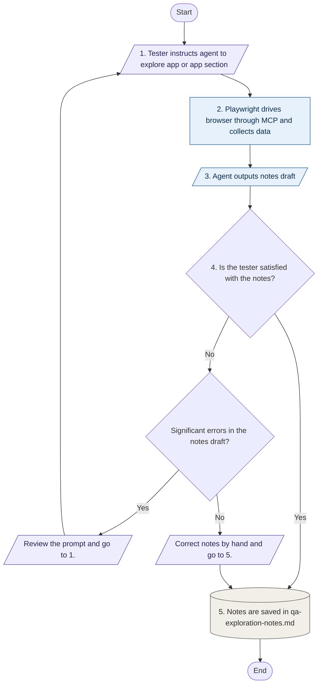
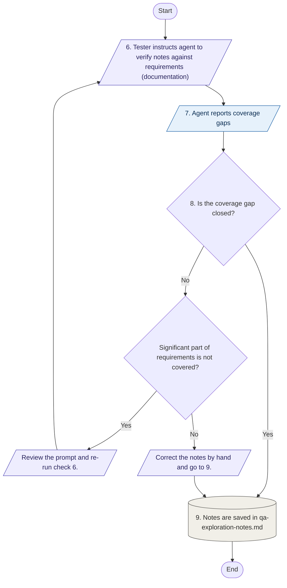
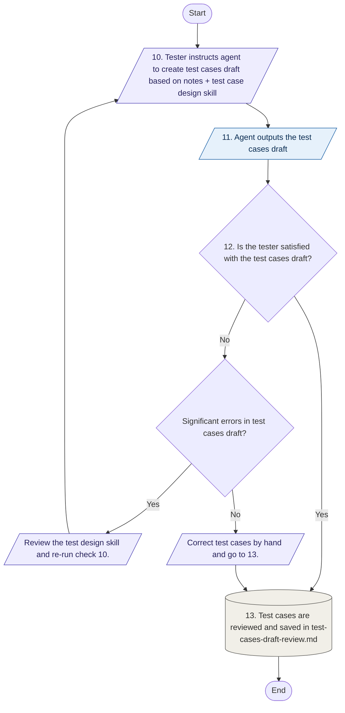

# Agentic Playwright Testing

This project demonstrates setting up a Playwright testing framework with MCP and Claude Code. The demo app used for testing is BookNow, a simple hotel-booking app. There are two versions of the app, `booknow-broken` with planted bugs and `booknow-fixed` without the known defects.

## How testing works in this project

Prompts are used to direct the process. The testing process has several phases:
1. Agent-assisted exploration of the app
2. Closing the coverage gap against requirements
3. Test case design
4. Implementing the test cases as Playwright specs

### Agent-assisted exploration of the app
The initial exploration does not use any requirement document, but relies on checks conducted by agent. 
When the exploration is done, agent outputs draft notes. It is on tester to decide whether the notes are correct and useful or not before saving them in `qa-exploration-notes.md`

### Closing the coverage gap against requirements

### Test case design

## Running the apps

Install dependencies:

    npm install
    npx playwright install chromium

BookNow is plain static files (`index.html`, `app.js`, `style.css`) with no backend or build step, so any static server works. From the repo root:

    npx serve booknow-broken     # app under test, http://localhost:3000
    npx serve booknow-fixed      # corrected app, http://localhost:3000

Both apps are served on port 3000, one at a time. `booknow-broken` is the app under test. `booknow-fixed` is used only to confirm that the tests pass once the bugs are fixed. Because both use the same URL, the same test suite runs against either app without any changes. Stop one server with `Ctrl+C` before starting the other.

## Credentials

| Email | Password |
| --- | --- |
| `guest@booknow.com` | `stay2026` |

This is a static practice app with no backend to protect, so these credentials are public on purpose. The project still follows these good practices:

- Playwright tests read the credentials from environment variables instead of hardcoding them:
  - `process.env.BOOKNOW_EMAIL`
  - `process.env.BOOKNOW_PASSWORD`
- Prompts for generating and healing tests instruct the AI not to hardcode credentials.
- `.gitignore` excludes `.env*` files, which can contain credentials and API keys. `.env.example` is still committed.
- `.gitignore` excludes Playwright output that could expose sensitive data:
  - `/playwright/.auth/`: saved login sessions, including cookies and local storage
  - `/test-results/`, `/playwright-report/` and `/blob-report/`: screenshots, videos or traces that can capture values entered during tests.

## Playwright MCP

Claude Code drives the browser through the [Playwright MCP server](https://github.com/microsoft/playwright-mcp).
It is configured at **local scope**, so the config lives in my `~/.claude.json`, not in this repo, and there is no `.mcp.json`.

Why local scope:
- It keeps machine-specific tool config out of the repo.
- The setup is documented and reproducible through a prompt instead.

To set it up on your machine, run the prompt in [`prompts/01-set-up-mcp.md`](prompts/01-set-up-mcp.md) in Claude Code, or run:

    claude mcp add --scope local playwright -- npx @playwright/mcp@latest
    npx playwright install chromium

The MCP server writes page snapshots and screenshots to `.playwright-mcp/`, which is gitignored.

## Authors

- [@MilosHajdukovic](https://github.com/MilosHajdukovic)
